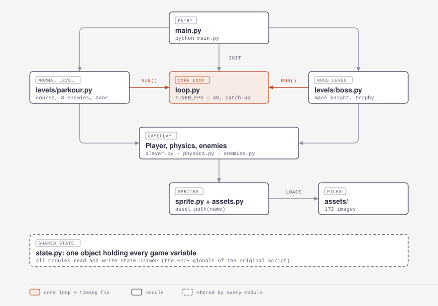
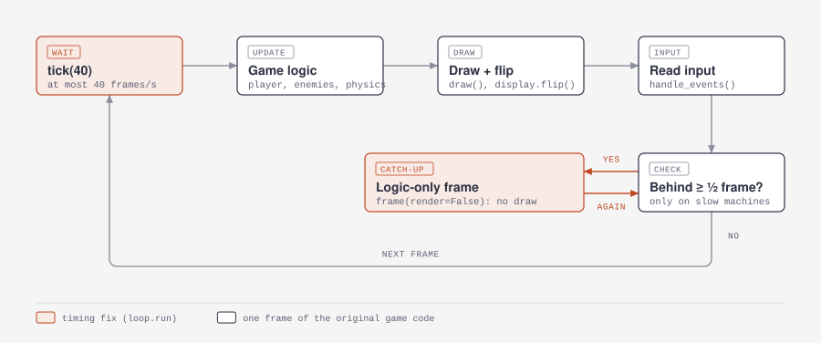

# Link's Dungeon

A side-scrolling dungeon crawler in Python and pygame, made by Ahron Ramos and Marcus Reid as a Grade 10 computer science final project (December 2019 to January 2020).

## The game

You play as Link. The first level is a parkour course: climb walls covered in vines, avoid spikes, and fight eight enemies. Each enemy turns to face you, shoots arrows when you are far away, runs at you when you get close, and swings a sword when you are right next to it.

When every enemy is dead, a door appears. It leads to the boss room. The boss, a mace knight, throws his mace when you are far away, grabs you with a chain at middle range, walks toward you, and hits you when you are close. Beat him and pick up the trophy to win.

There are three kinds of block, and each one works the same way on all four sides:

- Normal walls: you can walk on top of them, but you can't climb them or go through them.
- Vine walls: you can climb up, down and sideways while touching them.
- Spikes: they hurt you when you touch them. There is no other fall damage.

The panel in the top-left shows three bars:

- Red: health. It does not come back.
- White: shield. It takes hits before your health does and slowly refills. We added it after both playtesters said arrows were too hard to block.
- Blue: stamina. Each bow shot uses some, and it refills over time.

The game also prints its rules and controls in the console window when it starts.

## Controls

| Key | Action |
|---|---|
| A / D | Move left / right |
| Space | Jump |
| W / S | Climb up / down a vine wall |
| Mouse click | Attack with the current weapon |
| 1 / 2 | Switch to sword / bow and arrow |
| O | Open the door to the boss room (once it appears) |
| T | Pick up the trophy after the boss dies |

## Run from source

You need [uv](https://docs.astral.sh/uv/getting-started/installation/). From the project folder, on any OS:

```bash
uv run main.py
```

The first run creates `.venv` with Python 3.12 (from `.python-version`) and the pygame version locked in `uv.lock`. uv downloads Python 3.12 if you don't have it. The game needs Python 3.8 to 3.13, because pygame 2.6.1 has no packages for 3.14 yet. It finds its images relative to its own files, so `uv run --project <path> <path>/main.py` works from another folder too.

## Build an executable

```bash
uv run --group build build.py
```

This adds PyInstaller (the `build` group in `pyproject.toml`) to `.venv` and packs the game and all of `assets/` into one file: `dist\LinksDungeon.exe` on Windows, `dist/LinksDungeon` on macOS and Linux. The build keeps the console window, because the game prints its rules and controls there.

PyInstaller can only build for the system it runs on, so run `build.py` on each OS you need. The Windows build has been tested; the macOS and Linux builds have not. On macOS the file is unsigned, so the first time you may have to right-click it and choose Open.

## Run the tests

```bash
uv run python -m unittest discover -s tests -v
```

- `tests/test_smoke.py` starts the real game with no window, holds D for about 300 frames, closes it, and checks that it reached the normal ending.
- `tests/test_timing.py` fakes a 30 FPS machine and a 240 FPS machine, holds D for one second on each, and checks that the world scrolled the same distance (within 5%).

The tests use only Python's built-in `unittest`.

## Project layout



```
main.py                 entry point
game/
  loop.py               window setup, text drawing, the core loop and the timing fix
  state.py              one shared object that holds every game variable
  player.py             player animations, stats, damage and death, collisions, attacks
  physics.py            gravity, world scrolling, the looping background
  enemies.py            the eight enemies: animations, AI, arrows
  sprite.py             the Sprite class every object uses
  assets.py             finds image files next to the program (or inside the .exe)
  colors.py             colour constants
  levels/parkour.py     the normal level
  levels/boss.py        the boss room
assets/                 all 172 images
tests/                  smoke test and timing test
docs/                   the original planning document and these diagrams
legacy/                 three earlier versions of the game, kept unchanged
build.py                one-command build
pyproject.toml          dependencies (pygame; PyInstaller in the "build" group)
uv.lock                 exact versions uv installs
.python-version         the Python version uv uses (3.12)
```

The game started as one 2,900-line script with about 275 global variables. It was split into these files without changing what it does: each global became a field on the `state` object (`health` became `state.health`), and each level's `frame()` calls the pieces in the same order as the original loop. A frame-by-frame replay of the old and new code gave identical screens and variables.

The `legacy/` versions are the earlier files from the same folder: `Final Project.py`, `Final Project (Clean).py`, and an easier tuning in `Final Project (Easy).py`. All three start straight in the boss room. They still expect the old flat folder, so they won't run from `legacy/`; the `original` git branch has them in their runnable form.

## How the timing fix works



Every speed in the game is counted in frames, not seconds. Walking moves the world 4 pixels per frame, gravity adds 0.12 per frame, a sword swing hits on frame 40, and the shield refills after a set number of frames.

The original loop called `clock.tick(70)`, which caps the game at 70 frames per second. The school computer it was made on couldn't reach 70, so the game ran slower, and all those numbers were tuned at that slower speed. Any modern computer reaches the cap, so the game ran too fast.

`loop.run()` fixes this with two changes:

1. It caps the game at `TUNED_FPS = 40` frames per second instead of 70. On a fast machine, this is the only change.
2. On a machine too slow for 40, it keeps track of how far behind it is. When it falls half a frame or more behind, it runs extra frames with drawing turned off (`frame(render=False)`) until it has caught up. Game logic is the same in every frame; only the drawing is skipped.

The per-frame game code is unchanged. Moving everything to time-based movement would have meant rewriting it, because much of the code checks for exact frame numbers (`if count == 15`) and the collision checks expect small, fixed steps.

40 is an estimate of how fast the old computer ran; nothing in the code records it. To change the speed of the whole game, edit `TUNED_FPS` in `game/loop.py`.

The diagram shows each frame as update, then draw, then input. In the code, `frame()` runs a few updates, draws, runs the rest of the updates, flips the screen, and reads input last, the same order as the original.

## Known bugs

These come from the original game. The cleanup kept the game logic as it was, so they are all still there:

- You can go through walls at their edges.
- Hitting the left side of the spikes can do a lot of damage.
- The player gets stuck if you fire the bow with no stamina.
- Enemies can walk into each other.
- Some animations lag or glitch, especially in the boss room. This includes the chain and the death animations.
- The red part of the health bar for enemies 2 to 8 is drawn at enemy 1's height.
- Pressing T after the boss dies but before its death animation ends crashes the game (`trophy` doesn't exist yet).

## Credits

Ahron Ramos: enemy and boss AI, how each type of block behaves, player movement and attacks, damage, textures and animations.
Marcus Reid: parkour course design and tuning, sprite animations, planning.

Image sources (from the project's planning document):

- Player sprite sheet: http://www.zeldagalaxy.com/wp-content/img/sprites/snes/lttp/link-2.gif
- Enemy sprite sheet: https://opengameart.org/forumtopic/wip-simple-roguelike-spritesheet-and-tileset
- Boss sprite sheet: http://www.zeldagalaxy.com/wp-content/img/sprites/snes/lttp/mace-knight.gif
- Health bar: https://soul-knight.fandom.com/wiki/HUD
- Walls: http://pixelartmaker.com/art/6b5b87ade3ed58e
- Spikes: https://www.pixilart.com/art/spike-trap-2daea9f37ca2c48
- Parkour background: https://steamcommunity.com/sharedfiles/filedetails/?id=1434609021
- Boss room: https://www.nexusmods.com/darkestdungeon/mods/686

The player and boss sprites come from Nintendo's *The Legend of Zelda: A Link to the Past*.
